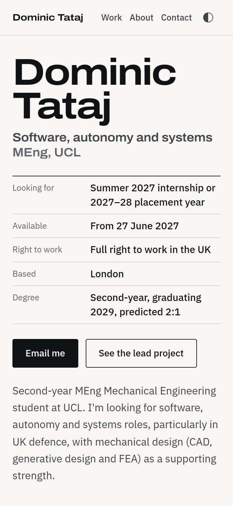
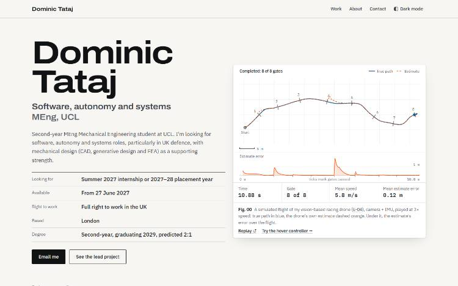
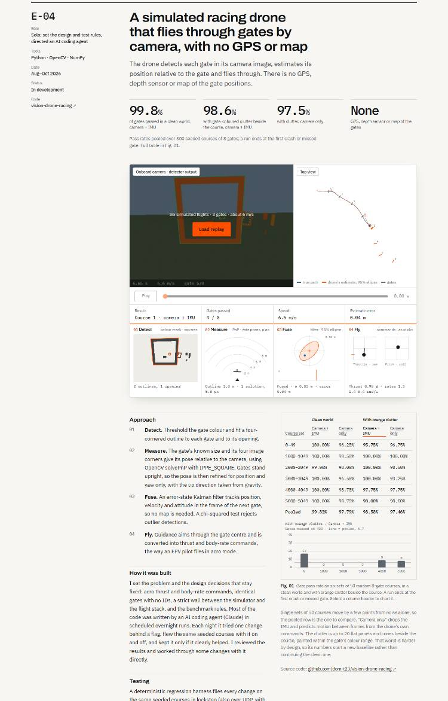
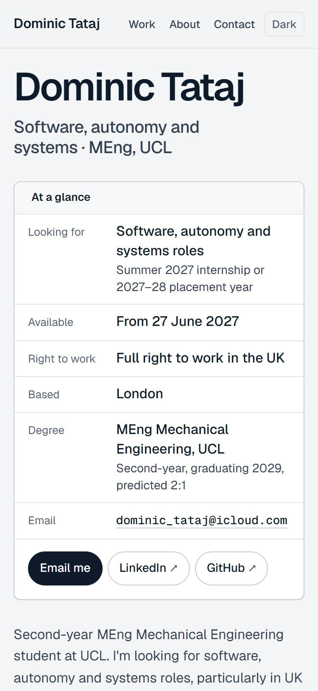
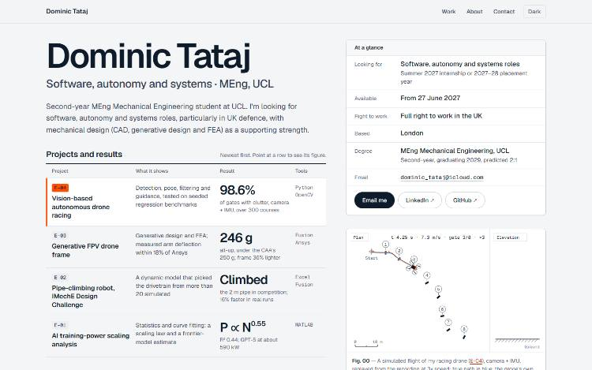
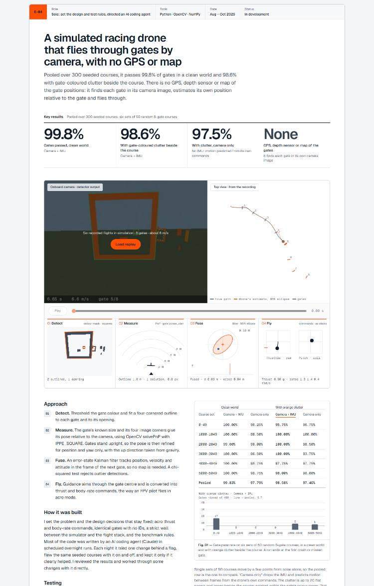
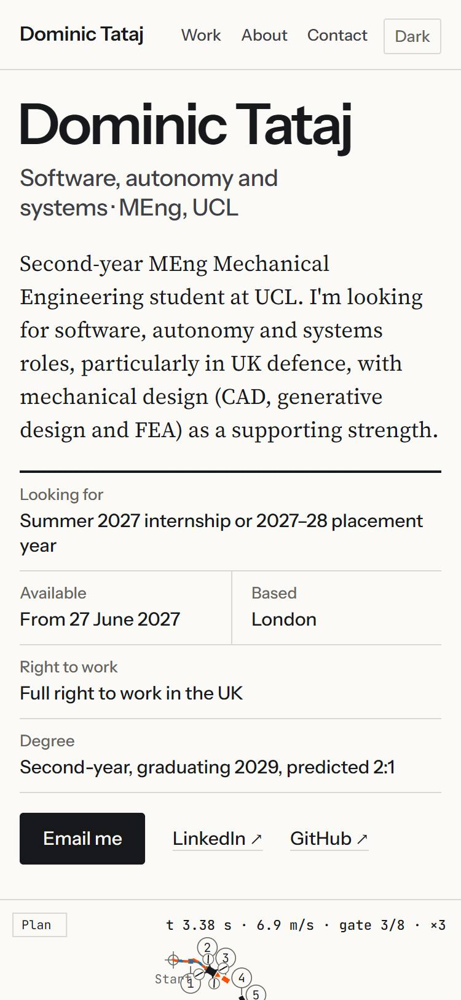
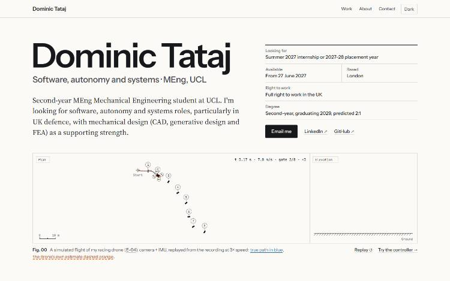
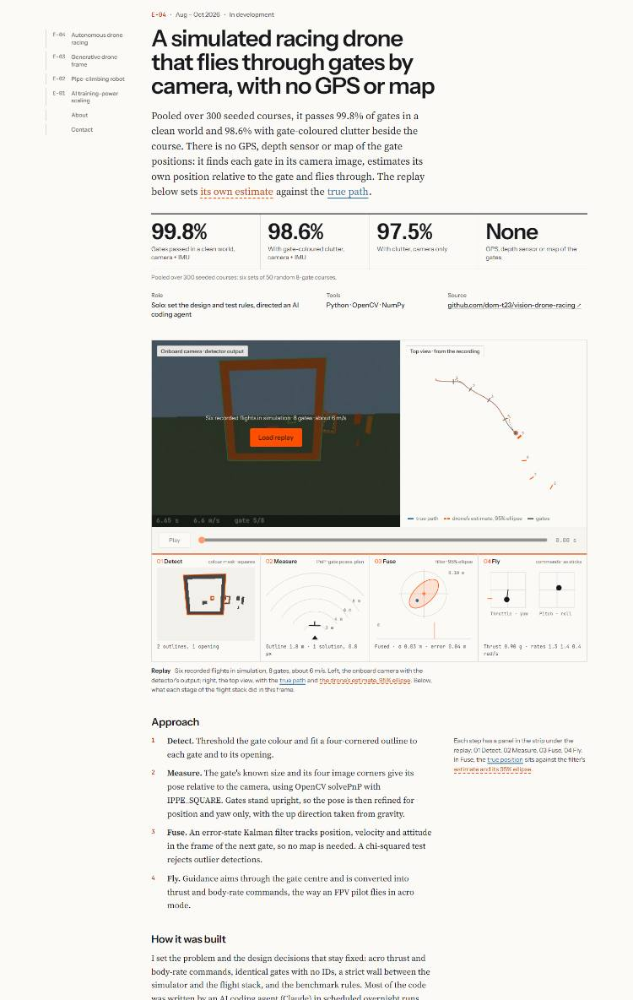

# Professional design review (Nov 2026)

Branch `claude/design-review`. Brief: `review/BRIEF.md` (sections 1 to 3 of Dom's prompt).
Baseline: `review/baseline/` (screenshots, `metrics.json`, `NOTES.md`). Reviewer reports:
`review/findings/<reviewer>.md`, each with an independent fact-check in `<reviewer>.verify.md`.
Status of the plan is tracked in `DESIGN_PLAN.md`, phase S.

## Executive summary

1. The work on this site is strong. The replay with its pipeline strip, the hover rig and the
   seeded regression harness are better evidence than most student portfolios have. But the page
   frames Dom as a mechanical engineer: the hero, title, meta and link preview all still say
   "mechanical roles first", which is the opposite of his new targeting (the one P0).
2. A recruiter on a phone can't say who Dom is or what he wants within 10 seconds. There is no
   visible name-and-role line, the autonomy project starts 8 screens down, and there is no CV.
3. The Phase R shell is careful but generic. Three of eight reviewers, including the art
   director, call it the stock SaaS-landing look, and visual design scores 6/10. What a reader
   remembers is the figures, and the shell doesn't frame them.
4. Under the redesign rule (visual-design overall under 7, a failed 10-second test, and two or
   more reviewers calling the look generic: all three hold), this is a **redesign** of the identity
   layer: type, hero, project anatomy and surfaces. The figures and the engineering underneath
   stay.
5. The order of work: the targeting copy first; then new tokens; then the hero, E-04 leading, phone
   density, honesty fixes in the figures, accessibility and performance. Several items need content
   only Dom has (CV, hardware photos, E-03 baselines, the E-01 model count).

## Scorecard

Each reviewer scored its own dimensions (1 to 10). "After" is filled in by the independent
verifier in phase 5.

| Reviewer | Dimension | Before | After |
|---|---|---|---|
| recruiter | 10-second clarity | 6 | |
| | 30-second skim | 4 | |
| | CTA and CV findability | 4 | |
| | Fit for defence/autonomy recruiters | 5 | |
| | Fit for software recruiters | 3 | |
| | Memorability | 6 | |
| | **Overall** (10-second test: FAIL) | **5** | |
| hiring-engineer | Ownership clarity | 6 | |
| | Quantified results | 7 | |
| | Method, testing and limitations | 6 | |
| | Value of the interactive figures | 7 | |
| | Project ordering for the target roles | 4 | |
| | Technical credibility | 7 | |
| | **Overall** | **6** | |
| visual-design | Typography | 6 | |
| | Grid and alignment | 6 | |
| | Spacing system | 6 | |
| | Colour and contrast | 6 | |
| | Hierarchy | 5 | |
| | Component consistency | 6 | |
| | Depth and elevation | 6 | |
| | Imagery | 6 | |
| | Dark theme | 6 | |
| | Distinctiveness and premium feel | 5 | |
| | **Overall** | **6** | |
| interaction-motion | Purposefulness | 6 | |
| | Smoothness | 7 | |
| | Discoverability | 6 | |
| | Interruptibility and control | 7 | |
| | Reduced-motion fallbacks | 9 | |
| | Touch behaviour | 6 | |
| | Scroll-linked effects | 4 | |
| | Cursor and micro-interactions | 7 | |
| | **Overall** | **6** | |
| accessibility | Contrast (light) | 5 | |
| | Contrast (dark) | 8 | |
| | Keyboard and focus | 7 | |
| | Semantics, landmarks and headings | 6 | |
| | Alternatives for non-text content | 8 | |
| | Target size | 6 | |
| | Reflow and zoom | 6 | |
| | Motion and reduced motion | 8 | |
| | **Overall** | **6.5** | |
| performance-seo | First-load weight | 7 | |
| | LCP | 7 | |
| | CLS | 5 | |
| | Font loading | 5 | |
| | Images | 7 | |
| | Lazy-loading and main thread | 6 | |
| | Metadata and SEO | 5 | |
| | Social cards | 3 | |
| | Structured data | 1 | |
| | **Overall** | **5** | |
| copy | Headline and first impression | 4 | |
| | Role and target clarity | 3 | |
| | Availability and logistics | 6 | |
| | Project titles and summaries | 5 | |
| | Scanability | 5 | |
| | Voice and consistency | 7 | |
| | UK spelling and mechanics | 7 | |
| | Microcopy and CTAs | 5 | |
| | **Overall** | **5** | |
| benchmark | Memorability | 6 | |
| | 10-second clarity | 5 | |
| | Craft | 7 | |
| | Proof of work | 6 | |
| | Credibility for engineering hiring | 6 | |
| | Distinctiveness | 6 | |
| | **Overall** | **6** | |

"Generic or template-like?": recruiter **yes**, visual-design **yes**, benchmark **yes (at the
fold)**; hiring-engineer no, interaction-motion no, copy no (voice); accessibility and
performance-seo did not assess it.

## Merged findings

About 150 findings from eight reports, merged into the list below. Sources are the reviewer IDs,
and the full evidence is in each report. The fact-checkers refuted none of the P0/P1 findings.
They corrected line numbers, one viewport (REC-06 measured 390×664; at 375×812 the page is 24.6
screens, with E-04 starting at 8.2), and three fixes; the corrected fixes are the ones used here.
Ranking is by severity, then reader impact (recruiters first), then effort.

### P0: broken, or blocks the 30-second read

| ID | Finding | Sources | Effort |
|---|---|---|---|
| R-01 | The hero, `<title>`, meta and OG descriptions and the hidden h1 target **mechanical roles first**, the reverse of Dom's targeting. All three recruiter personas filed him under mechanical. "Defence" appears 0 times; "software" once. | REC-01, COPY-01, PERF-02, BEN-02, IMPROVEMENTS open P1 | S |

### P1: clearly hurts

| ID | Finding | Sources | Effort |
|---|---|---|---|
| R-02 | **No visible who-and-what line.** The largest type above the fold is a 20 px grey lede; the name is only in the nav. The availability pills are the loudest object. | VIS-01, BEN-01, COPY-08, A11Y-14 | S |
| R-03 | **The shell is the generic SaaS starter kit**: off-white page, white rounded cards, layered soft shadows, dot grid and glows, glass nav, capsules for everything, Space Grotesk. Card-in-card nesting goes four levels deep. The figures, which readers remember, are boxed as widgets. | VIS-02, VIS-07, VIS-09, REC and BEN verdicts | L |
| R-04 | **The autonomy project comes second** and starts on screen 8 of 24.6 on a phone, after E-03 and Fig. 01's pinned 3D track. | REC-03, ENG-01, COPY-07, BEN-05 | M |
| R-05 | **E-04 has no key-figure cards.** Its headline numbers (99.8%, 98.6%, 97.5% over 300 courses) are mid-paragraph, and before LOAD its readout shows four dashes that look broken. | REC-04, COPY-03, ENG-14, MOT-07 | S |
| R-06 | **E-04's ownership is framed by its weakest fact.** The first chips read "Individual, with an AI agent · In development". What Dom owned (the architecture constraints, the test process and benchmark, the sim sign bug) is buried in prose. | REC-05, ENG-02, COPY-13 | S (detail needs Dom) |
| R-07 | **No CV anywhere, and the email isn't a link.** The brief requires "how to contact me or get my CV" within 30 seconds. | REC-02, REC-10, COPY-06 | S (CV needs Dom) |
| R-08 | **The phone page is 24.6 screens long.** Fig. 01's pinned scrub costs about 2.2 screens and pushes E-03's numbers 3.5 screens below its title. Every project's full method prose is laid out, so a 30-second skim ends inside E-04. | REC-06, MOT-02, VIS-14 | M |
| R-09 | **Phone density.** Stat cards stack one per row, chips wrap to five rows, the nav takes two rows (77 px, sticky), and the About table collapses to a 134 px column. At 320 px (400% zoom) the table forces the whole page to scroll sideways. | VIS-05, REC-15, VIS-13, REC-18, VIS-11, REC-14, A11Y-05 | S–M |
| R-10 | **Count-ups show false values.** Each number reads "0.0" until it is scrolled to, and mid-count captures read "−22% mass" or "184 Hz". Assistive tech gets the zeros. This breaks "readable at frame 0". | MOT-01, A11Y-01, ENG-10, VIS-15 | S |
| R-11 | **Contrast fails AA in light.** `--muted` #6B7385 is 4.32:1 on the page; white on orange is 3.30:1 (light) and 3.12:1 (dark); the focus ring is 2.4:1. | VIS-03, A11Y-02, A11Y-03, A11Y-06 | S |
| R-12 | **Figure labels are the drawing set's uppercase tracked mono, and uppercasing corrupts units**: "38 G", "T 3.10 S", "M/S", "2 M CLIMBED", "RAD/S". | VIS-04, COPY-11 | M |
| R-13 | **Claims overstated.** Fig. 00 calls a simulated flight a "flight test" and "vision-only", but the flight shown is camera + IMU. E-04's title says "only its onboard camera" while its headline numbers are camera + IMU. The rig calls E-04's simulated drone "my 246 g drone", which is E-03's mass. | ENG-03, BEN-04, COPY-04 | S |
| R-14 | **E-01 contradicts itself**: 358 models in the summary and stat card, 603 in Fig. 07, whose fit is the one the cards report. | ENG-04, COPY-05, REC-19 | S (needs Dom) |
| R-15 | **E-02 presents a 10 ms Euler step** that the site's own corrected model (Fig. 04) calls unstable, with no limitation stated. | ENG-05 | S |
| R-16 | **E-03's key figures are half constraints** (1.5, >300 Hz), with no named baseline for −36% and no measured values for the 18% deflection agreement. | ENG-06 | S (needs Dom) |
| R-17 | **The link preview (`og-image.png`) is the retired drawing-set design**, with a serif name and no role or availability. Every recruiter sees it first, on LinkedIn. | PERF-01, REC-07, COPY-16, BEN-09 | M |
| R-18 | **The theme button appears after first paint** and reflows the nav: CLS 0.188 on a throttled phone. | PERF-03 | S |
| R-19 | **The hero's motion goes to a decorative drone** while the data-carrying Fig. 00 sits under the fold on a laptop (y ≈ 850 of 900) and before "Projects", without context, on a phone. | MOT-03, BEN-07, REC-12, MOT-04, MOT-06 | M |
| R-20 | **Fig. 02, 05 and 06 render their text at about 6 px on a phone** (a 520-unit viewBox scaled into 306 px). Not a WCAG failure, as the fact-checker noted, but unreadable. | A11Y-04 | M |
| R-21 | **Project summaries state the brief, not the result** (E-03, E-02); results come screens later. | COPY-02 | S |
| R-22 | **There is no photo of any hardware Dom built**; the only photographs are travel shots. | BEN-03, VIS-17 | needs Dom |

### P2: polish

| ID | Finding | Sources |
|---|---|---|
| R-23 | Project cards list tools, not results, and have no image. | VIS-12, REC-11, COPY-09, BEN-06 |
| R-24 | Dark theme: surfaces merge (paper on bg 1.08:1); Fig. 02's bar becomes a pale slab; the primary button inverts to the loudest object; the true-path blue is hard-coded (3.3:1 in dark). | VIS-06 |
| R-25 | No type or spacing scale: 18 rendered sizes, hand-set gaps, dead bands (about 190 px after Fig. 00 and before Contact), "Projects" introduced twice. | VIS-08, VIS-14 |
| R-26 | Component drift: 11 radii against 3 tokens, three segmented controls, three slider styles, capsules for facts, tags and actions alike. | VIS-09 |
| R-27 | Fig. 01's parts list overflows its margin, its caption sits outside its panel, and its Mass column is blank for 8 of 9 rows. | VIS-10, ENG-11 |
| R-28 | Year of study, graduation and predicted 2:1 are 20 screens down; "UK, no sponsorship" reads two ways (IMPROVEMENTS decided "full right to work"). | REC-08, REC-09, COPY (weakest-ten 4) |
| R-29 | The autonomy vocabulary recruiters scan for is missing though true ("GPS-denied", "state estimation", "sensor fusion"). About lists Programming after mechanical, and E-04's skills aren't there. | REC-13, COPY-15 |
| R-30 | Semantics: availability and spec rows read as run-on strings; Fig. 03's group and row headers aren't exposed; headings skip h2 to h4; no skip link; inline links aren't underlined; the hero drone link's name doesn't contain its visible text; "Copy email" isn't announced. | A11Y-07 to -10, -13 to -15, PERF-17 |
| R-31 | The parts-list buttons are under 24×24 px. | A11Y-11 |
| R-32 | Loops: the hero drone and Fig. 00 run for 45 s with no pause (2.2.2); the replay keeps animating off screen; Fig. 00 never idles. | A11Y-12, MOT-06, MOT-09, PERF-06 |
| R-33 | The open hover rig traps vertical scroll on phones; the rig and Fig. 03's chart-on-click are hard to discover. | MOT-05, MOT-08 |
| R-34 | Loading: Google Fonts are render-blocking with no preload or metric-matched fallback; content-visibility gives an intermittent 0.54 shift while scrolling throttled; the climber masks (202 KB PNG) load on every device; three.js mounts after 2.5 s on laptops without any scrolling (140 to 160 ms long tasks); the perf test serves uncompressed and is flaky at its limit. | PERF-04, -05, -07, -08, -10 |
| R-35 | No JSON-LD `Person` / `ProfilePage`. | PERF-09 |
| R-36 | Limitations and baselines missing: E-01's interval is wider than "an order of magnitude"; E-02's 22%/16% have no baseline; E-04 has no sim-to-real or acceptance-rule statement; the rig's ownership is unclear. | ENG-07, -08, -09, -12 |
| R-37 | Microcopy: Fig. 03's "run 20 / run 26" is internal jargon; "The sheet's setup" button; stat labels such as "Vs plate design". | ENG-13, COPY-10, -12, -14 |
| R-38 | Only E-04 links to an artefact (repo); no report, model or result file for the others. | BEN-08 |

P3 items (backlog) are listed at the end.

### Conflicts between reviewers, and how they were resolved

1. **A visible headline vs H.3 (Dom, 14 Nov: no visible headline).** Visual, benchmark and copy
   ask for a visible display line, and the recruiter test fails without one. Resolution: reopen
   H.3 for a *name and role line*, not a slogan. The h1 becomes visible: "Dominic Tataj" plus one
   plain line naming the target roles. That keeps the spirit of H.3 (no marketing headline) and
   fixes R-02.
2. **Count-ups: remove (motion, engineer) vs keep with an aria-hidden overlay (accessibility).**
   Resolution: remove the count-up from key figures. It carries no information, and §5 says
   content must be readable at frame 0. DESIGN_PLAN 2.4 becomes `[-]`.
3. **White text on orange: switch the text to ink (accessibility) vs a darker orange fill
   (visual).** The fact-checkers showed both dark-theme variants as written fail. Resolution: a
   fixed `--on-signal` text colour (near-black, the same in both themes) on the bright orange for
   small labels, and a darker `--signal-strong` fill under white text only where white is needed.
   Values are checked in the token batch.
4. **What fills the hero's visual slot: the drone drawing (Phase R, H.1) or Fig. 00 (motion,
   benchmark).** This is settled by the direction study (phase 3). The constraint either way: one
   moving thing in the hero, and it must carry information.
5. **Project numbering.** With E-04 first, the page reads E-04, E-03, E-02, E-01, newest first and
   in sequence, so no renumbering of E-codes is needed; figure numbers follow page order (as
   IMPROVEMENTS item 2 did).
6. **CV: IMPROVEMENTS item 10 (dropped 24 Oct at Dom's request) vs the 20 Nov brief ("how to …
   get my CV").** No CV file exists in the repo, so there is no link (no dead or placeholder link
   on a live site). The markup for the button is left ready, commented out, and the CV is first
   under Needed from Dom.
7. **Phone method prose: collapse it behind `
` (recruiter) vs keep detail visible
   (engineer, §5 "readable at frame 0").** Resolution: keep everything visible, and shorten
   the phone page instead by unpinning Fig. 01 on narrow screens, putting key figures directly
   under each summary, 2×2 stat grids, and a one-line metadata row in place of five chip rows.
   Revisit only if the re-audit still fails the 30-second skim.

## Decision: **redesign** (of the identity layer)

The rule in the brief says redesign if any of these hold. All three do:

- visual-design overall = **6** (< 7);
- recruiter 10-second test = **FAIL** (the roles stated are the wrong ones, and there is no
  visible who-and-what line);
- **three** reviewers independently call the look generic or template-like (recruiter,
  visual-design, benchmark).

What it means: the shell (type pairing and scale, hero composition, project anatomy, surface and
pill vocabulary, colour roles) is redesigned. The constraints in the brief still hold: light
first, no drawing-set identity, the crosshair cursor and film strip kept, no sound, build-free.
The figures, their data and the motion system stay; they are the site's strongest material, and
the redesign's job is to frame them.

Direction study: see **Direction** below (three prototypes in separate worktrees, judged blind).

## Direction

Three directions were briefed (`review/directions/BRIEFS.md`) and prototyped, each in its own git
worktree (branches `proto/dir-A`, `proto/dir-B`, `proto/dir-C`, kept locally; the worktrees have
been removed). Each covered the hero, E-04 and About with real content. A fresh judge who had
seen none of the work scored only the screenshots, the brief and the benchmark
(`review/directions/JUDGEMENT.md`). Weighting: 10-second clarity 30%, credibility 30%,
memorability 15%, craft 15%, fit 10%.

| Direction | Concept | 10-s clarity | Memorability | Craft | Credibility | Fit | **Weighted** |
|---|---|---|---|---|---|---|---|
| A, "Flight log" | Archivo semi-expanded, Plex Sans/Mono, warm white, hairline rules, no cards; Fig. 00 as a complete flight log beside the name | 8 | 7 | 8 | 8 | 8 | **7.85** |
| B, "Brief" | Geist/Geist Mono, navy on white; an "at a glance" fact card and a projects-and-results table in the first screen | 9 | 7 | 8 | 9 | 9 | **8.55** |
| C, "Field notes" | Instrument Sans with Source Serif body, editorial; full-width Fig. 00, colour-keyed prose, sticky index | 8 | 7 | 7 | 7 | 8 | **7.40** |

**Decision: B's information design in A's visual system, with C's colour-keyed captions** (the
judge's hybrid). B won the two heaviest criteria (the only phone fold with every screening fact,
the written-out email and LinkedIn/GitHub; the only desktop fold with a result for every
project). Its weakness was looking closest to the generic shell; the judge's hybrid takes A's
answer to that (flat ruled fact list, square buttons, unboxed projects with a margin column, the
complete Fig. 00) and C's caption keys. B's card-with-labelled-cells project header was flagged
as reading like a drawing-set title block, so it was not used.

Built on the main branch in `b7cec75` and the commits after it. One judgement call beyond the
spec: A's type and palette (Archivo/Plex, warm white) were kept for the whole page rather than
B's Geist/navy, because the judge's grafts already took A's treatment for every visible component
and mixing two systems would have undone the consistency the art director asked for. C's sticky
index was left out (the judge's fallback: A's metadata column and the index don't both fit).

The losing directions, as prototyped (JPEG copies; full PNGs are regenerable):

| | Phone fold | Desktop fold | E-04, desktop |
|---|---|---|---|
| A |  |  |  |
| B |  |  |  |
| C |  |  |  |

## Plan

Each batch is one commit and references finding IDs. P0 first, then P1, then P2 as time allows.
The visual batches follow the winning direction.

| Batch | Contents | Findings |
|---|---|---|
| S.1 | **Targeting copy** (P0): hero eyebrow and lede, h1 text, `<title>`, meta and OG descriptions, About's first paragraph, Contact line, right-to-work wording, year and 2:1 in the hero; autonomy vocabulary where true. | R-01, R-28, R-29 |
| S.2 | **Foundations**: tokens for the new direction: type scale, spacing scale, colour roles (with the contrast fixes and `--on-signal`), elevation, radii, motion; fonts. | R-11, R-25, R-24 (tokens), R-34 (fonts) |
| S.3 | **Hero**: visible name-and-role h1, availability as a typeset spec list, CTAs, the hero visual per the direction, one-row phone nav, a theme button that exists before first paint. | R-02, R-19, R-09 (nav), R-18 |
| S.4 | **E-04 leads**: reorder projects and the register (E-04, E-03, E-02, E-01), renumber figures, project cards with one result each, tests updated. | R-04, R-23 |
| S.5 | **Project anatomy**: the new sheet layout; metadata as one line; key figures straight under each summary, 2×2 on phones; E-04 key figures; the readout's empty state; summaries that lead with the result; E-04's ownership line. | R-03, R-05, R-06, R-09, R-21 |
| S.6 | **Accuracy**: Fig. 00 and rig captions and readouts; E-04 title; E-01 model count wording; E-02 limitation; count-ups removed. | R-10, R-13, R-14, R-15, R-36 (part) |
| S.7 | **Phone length and figure legibility**: Fig. 01 unpinned under 600 px and a shorter pin elsewhere; Fig. 02, 05 and 06 redrawn for phones; parts-list fit and target size. | R-08, R-20, R-27, R-31 |
| S.8 | **Figure language**: sentence case and correct units in every figure; one tag, one segmented control, one slider style. | R-12, R-26 |
| S.9 | **About and Contact**: the skills table's phone layout and reflow, software first, `mailto:` email, copy status announced; the CV slot ready for the file. | R-07, R-09, R-29, R-30 (part) |
| S.10 | **Accessibility**: semantics (lists, `dl`, table headers, headings, skip link, link underlines, the drone link's name), loops that settle, the rig on touch. | R-30, R-32, R-33 |
| S.11 | **Performance and SEO**: JSON-LD, theme-color in dark, sheet size placeholders, the replay loop paused off screen, climber masks lazy and WebP, three.js on interaction, a gzip test server, a regenerated `og-image.png` from a reproducible page. | R-17, R-34, R-35 |
| S.12 | **Dark theme pass** and screenshot review in both themes. | R-24 |

## Assumptions

- **Screenshots in git**: full-resolution PNGs (about 43 MB for the baseline) aren't committed;
  they would bloat the repo's history forever and GitHub Pages would serve them. Committed copies
  are JPEGs at most 750 px wide (`tools/review/shrink-shots.cjs`), in `review/baseline-jpg/` and
  `review/after-jpg/`. The PNGs can be regenerated with the capture spec.
- **Python**: `python3` on this machine is the Microsoft Store stub, so the Playwright config's
  `python3 -m http.server` can't start; tests here ran against `python -m http.server 4173`,
  which `reuseExistingServer` picks up. The config is unchanged for Dom's machine.
- **Pre-existing failures**: 7 tests fail under default parallelism on this machine and all pass
  serially (`review/baseline/NOTES.md`). They are treated as flaky under load, not as regressions.
- **H.3 reopened**: a visible h1 with the name and a plain role line (conflict 1). It is a role
  statement, not a slogan; if Dom wants it gone, it's a one-line change.
- **Targeting wording**: "Software, autonomy and systems roles, particularly in UK defence", taken
  from the brief. Software firms are the third reader, so "particularly" stays rather than "only".
- **No CV link** until Dom supplies a file (conflict 6).
- **E-01's model count**: until Dom says which count the fit used, the copy states both facts the
  repo supports without guessing their relationship (see S.6).
- **Clearance eligibility** is not stated anywhere: it isn't in the repo.

## Needed from Dom

1. **A CV PDF** without a phone number (ideally a software and autonomy version). The button
   markup is ready in `index.html`, commented out.
2. **Hardware photos**: the printed frame (ideally on a scale), the assembled drone, the
   deflection test, the robot on the pipe (R-22).
3. **E-01**: which model count the coursework's fit used, 358 or 603, and how the two relate (R-14).
4. **E-03**: the plate frame behind −36% and its mass; measured and predicted tip deflection; the
   achieved first mode and minimum safety factor from Ansys; whether it has flown (R-16); part
   masses for Fig. 01's parts list (R-27).
5. **E-04**: which parts of the flight stack he wrote or rewrote himself and how many agent
   changes he rejected (R-06); the simulator's name, the acceptance rule and any hardware plan
   (R-36); whether it is still in development, so the date can read "Aug 2026 – present".
6. **E-02**: the baseline drivetrain and absolute predicted and measured times, and the number of
   runs (R-36).
7. **Artefacts** he can share: the E-01 report, the E-02 model, an E-03 Ansys image (R-38).
8. **Optional**: whether to state UK security-clearance eligibility (only if true).
9. **Search Console**: verify the site property and request re-indexing after merge (PERF-12).

## P3 backlog

REC-16 (codes out of order: resolved by S.4), REC-17 (leadership row higher), PERF-11 (dark
theme-color: in S.11 if cheap), PERF-12 (`og:site_name`, `og:locale`), PERF-13 (favicon set),
PERF-14 (AVIF/WebP photos), PERF-15 (hero frame sprite), PERF-16 (split the reveal setup task),
MOT-10 (acro tilt scrolls sideways), MOT-11 (cursor readout over figures), MOT-12 ("tap"
wording on touch), MOT-13 (rig slider keyboard step), VIS-16 (drone tag position), VIS-18
(`sup` in stat cards, Fig. 07 axis title), VIS-19 (sprocket holes), COPY-17 (house style for
ranges), COPY-18 (theme button label), COPY-19, COPY-20, A11Y-16 (rig and Fig. 01 keyboard and
live regions), A11Y-17, BEN-10 (a dated "latest" line on E-04), BEN-11 (a "how this site is
built" footer line), ENG-15 (small cross-section inconsistencies).
